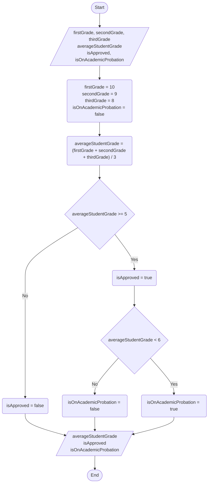

<div align="center">

  🇧🇷 **[Versão em Português](README.pt-BR.md)**
  <br>

  # ⚖️ Grade Approval and Decision Flow (`GradeApprovalFlow.ts`)

</div>

> **Origin:** Class 04 (Conditional Structures, Flowcharts, and Desk Checking)  
> **Topic:** Compound `if`/`else` Conditions, ISO/ANSI Flowcharts, and RAM Desk Checking

---

## 🎯 Problem Statement

In this exercise, I calculated the average of three student grades and used compound `if`/`else` rules to determine the final status:
- **Average < 5:** Failed (`isApproved = false`, `isOnAcademicProbation = false`).
- **5 <= Average < 6:** Approved on probation / recovery (`isApproved = true`, `isOnAcademicProbation = true`).
- **Average >= 6:** Direct approval (`isApproved = true`, `isOnAcademicProbation = false`).

---

## 📊 Flowchart (ISO / ANSI)



---

## 🧪 Desk Checking (RAM Memory Trace)

Manual trace tracking each variable step by step before running the code:

| Execution Step | `firstGrade` | `secondGrade` | `thirdGrade` | `averageStudentGrade` | `isApproved` | `isOnAcademicProbation` |
| :--- | :--- | :--- | :--- | :--- | :--- | :--- |
| **Variable Declaration** | `undefined` | `undefined` | `undefined` | `undefined` | `undefined` | `undefined` |
| **Initialization and Input** | `10` | `9` | `8` | `undefined` | `undefined` | `false` |
| **Arithmetic Processing** | `10` | `9` | `8` | `9.0` | `undefined` | `false` |
| **Condition 1 (`>= 5`)** | `10` | `9` | `8` | `9.0` | `true` | `false` |
| **Condition 2 (`< 6`)** | `10` | `9` | `8` | `9.0` | `true` | `false` |

---

## 💻 Source Code

The full implementation is available in [GradeApprovalFlow.ts](GradeApprovalFlow.ts).

---

## 🖥️ Terminal Output

```text
Average: 9
Approved: true
On Probation: false
```

---

## 💡 Key Concepts Applied

- **Conditional Branching (`if` / `else`):** Splitting execution paths based on boolean checks.
- **Decision Diamonds (ISO/ANSI):** Modeling nested decisions (`>= 5` followed by `< 6`) visually before coding.
- **RAM Desk Checking:** Simulating each variable transition manually to catch logic mistakes early.
- **Boolean Naming:** Using `is` prefixes (`isApproved`, `isOnAcademicProbation`) so conditions read naturally.

---

## 🚀 How to Run

```bash
# Direct execution via tsx
npx tsx src/05-grade-approval-flow/GradeApprovalFlow.ts
```
