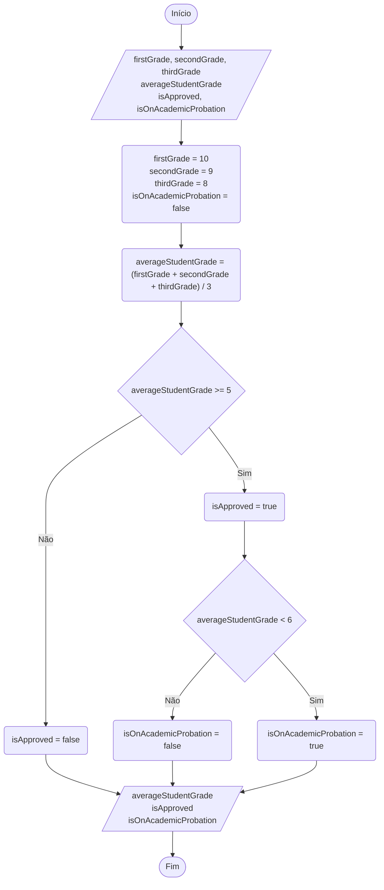

<div align="center">

  🇺🇸 **[English Version](README.md)**
  <br>

  # ⚖️ Aprovação de Notas e Fluxo Decisório (`GradeApprovalFlow.ts`)

</div>

> **Origem:** Aula 04 (Estruturas Condicionais, Fluxogramas e Teste de Mesa)  
> **Tópico:** Condicionais Compostas (`if`/`else`), Fluxogramas ISO/ANSI e Teste de Mesa

---

## 🎯 Enunciado do Problema

Neste exercício, calculei a média aritmética de três notas e usei condicionais `if`/`else` para definir a situação do aluno:
- **Média < 5:** Reprovado (`isApproved = false`, `isOnAcademicProbation = false`).
- **5 <= Média < 6:** Aprovado com recuperação (`isApproved = true`, `isOnAcademicProbation = true`).
- **Média >= 6:** Aprovado direto (`isApproved = true`, `isOnAcademicProbation = false`).

---

## 📊 Fluxograma (Norma ISO / ANSI)



---

## 🧪 Teste de Mesa (Rastreamento na Memória RAM)

Simulação manual passo a passo para conferir o valor de cada variável antes de rodar o código:

| Momento da Execução | `firstGrade` | `secondGrade` | `thirdGrade` | `averageStudentGrade` | `isApproved` | `isOnAcademicProbation` |
| :--- | :--- | :--- | :--- | :--- | :--- | :--- |
| **Declaração** | `undefined` | `undefined` | `undefined` | `undefined` | `undefined` | `undefined` |
| **Inicialização e Entrada** | `10` | `9` | `8` | `undefined` | `undefined` | `false` |
| **Processamento Aritmético** | `10` | `9` | `8` | `9.0` | `undefined` | `false` |
| **Condicional 1 (`>= 5`)** | `10` | `9` | `8` | `9.0` | `true` | `false` |
| **Condicional 2 (`< 6`)** | `10` | `9` | `8` | `9.0` | `true` | `false` |

---

## 💻 Código-Fonte

O código completo está em [GradeApprovalFlow.ts](GradeApprovalFlow.ts).

---

## 🖥️ Saída no Terminal

```text
Average: 9
Approved: true
On Probation: false
```

---

## 💡 Principais Conceitos Aplicados

- **Desvios Condicionais (`if` / `else`):** Separar os caminhos do algoritmo conforme o resultado booleano das comparações.
- **Losangos de Decisão (ISO/ANSI):** Desenhar as decisões encadeadas (`>= 5` seguido de `< 6`) antes de programar.
- **Teste de Mesa:** Acompanhar cada mudança de variável manualmente para pegar erros de lógica cedo.
- **Nomenclatura Booleana:** Usar prefixos com `is` (`isApproved`, `isOnAcademicProbation`) para facilitar a leitura das condições.

---

## 🚀 Como Executar

```bash
# Execução direta via tsx
npx tsx src/05-grade-approval-flow/GradeApprovalFlow.ts
```
