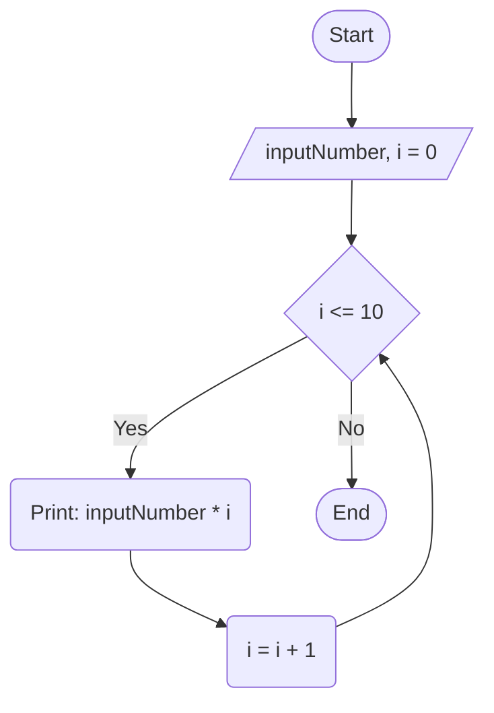

<div align="center">

  🇧🇷 **[Versão em Português](README.pt-BR.md)**
  <br>

  # ✖️ Multiplication Table with for Loop (`MultiplicationTable.ts`)

</div>

---

## 🎯 Problem Statement

Prompt the user for a numerical input between 0 and 10 and display its complete multiplication table (from 0 to 10) using a counted `for` loop, comparing the professor's direct inline calculation with my exploratory approach in class using an intermediate variable.

---

## 📊 Flowchart (ISO / ANSI)



---

## 🧪 Desk Checking (RAM Memory Trace)

Simulation for input `inputNumber = 7` (Option 1 - Direct Calculation):

| Iteration `i` | `inputNumber` | Condition (`i <= 10`) | Operation | Output Printed |
| :---: | :---: | :---: | :---: | :--- |
| **0** | `7` | `true` | `7 * 0` | `7 * 0 = 0` |
| **1** | `7` | `true` | `7 * 1` | `7 * 1 = 7` |
| **2** | `7` | `true` | `7 * 2` | `7 * 2 = 14` |
| **...** | `7` | `true` | `...` | `...` |
| **10** | `7` | `true` | `7 * 10` | `7 * 10 = 70` |
| **11** | `7` | `false` | - | *(Loop terminates)* |

---

## 💻 Source Code

The implementation is available directly in [`MultiplicationTable.ts`](MultiplicationTable.ts).

---

## 🖥️ Terminal Output

```text
========================================
     Multiplication Table with for
========================================
1 - Direct calculation (Professor's approach)
2 - With intermediate variable (My approach in class)

Table of 7:
7 * 0 = 0
7 * 1 = 7
7 * 2 = 14
7 * 3 = 21
7 * 4 = 28
7 * 5 = 35
7 * 6 = 42
7 * 7 = 49
7 * 8 = 56
7 * 9 = 63
7 * 10 = 70
========================================
```

---

## 💡 Key Concepts Applied

- **Counted Repetition (`for` loop):** Using a 3-part loop structure (counter initialization, termination condition, and step incrementation).
- **Comparison of Approaches:** Direct evaluation inside output (`inputNumber * i`) vs. storing in an intermediate variable (`intermediateResult = inputNumber * i`).
- **3-Phase Variable Lifecycle:** Clean separation between Declaration, Initialization, and Processing.

---

## 🚀 How to Run

```bash
# Direct execution via tsx
npx tsx src/07-multiplication-table/MultiplicationTable.ts
```
