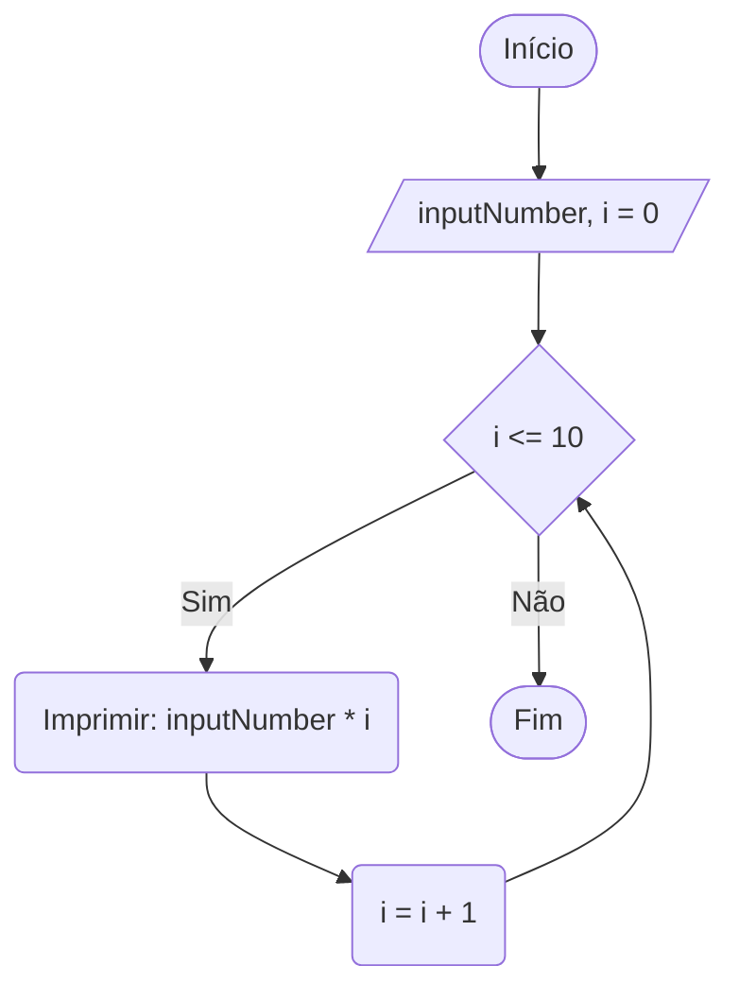

<div align="center">

  🇺🇸 **[English Version](README.md)**
  <br>

  # ✖️ Tabuada com Repetição for (`MultiplicationTable.ts`)

</div>

---

## 🎯 Enunciado

Solicitar ao usuário um número inteiro de 0 a 10 e exibir a respectiva tabuada completa (de 0 a 10) utilizando uma estrutura de repetição contada `for`, comparando o cálculo direto em linha demonstrado pelo professor com a minha abordagem inicial em aula utilizando variável intermediária.

---

## 📊 Fluxograma (Norma ISO / ANSI)



---

## 🧪 Teste de Mesa (Rastreamento na Memória RAM)

Simulação para a entrada `inputNumber = 7` (Opção 1 - Cálculo Direto):

| Iteração `i` | `inputNumber` | Condição (`i <= 10`) | Operação | Saída no Terminal |
| :---: | :---: | :---: | :---: | :--- |
| **0** | `7` | `true` | `7 * 0` | `7 * 0 = 0` |
| **1** | `7` | `true` | `7 * 1` | `7 * 1 = 7` |
| **2** | `7` | `true` | `7 * 2` | `7 * 2 = 14` |
| **...** | `7` | `true` | `...` | `...` |
| **10** | `7` | `true` | `7 * 10` | `7 * 10 = 70` |
| **11** | `7` | `false` | - | *(Repetição encerra)* |

---

## 💻 Código Fonte

A implementação está disponível diretamente em [`MultiplicationTable.ts`](MultiplicationTable.ts).

---

## 🖥️ Saída no Terminal

```text
========================================
     Multiplication Table with for
========================================
1 - Direct calculation (Professor's approach)
2 - With intermediate variable (My approach in class)

Table of 7:
7 * 0 = 0
7 * 1 = 7
7 * 2 = 14
7 * 3 = 21
7 * 4 = 28
7 * 5 = 35
7 * 6 = 42
7 * 7 = 49
7 * 8 = 56
7 * 9 = 63
7 * 10 = 70
========================================
```

---

## 💡 Conceitos Aplicados

- **Repetição Contada (`for`):** Estrutura em três partes (inicialização do contador, condição lógica de parada e incremento a cada passo).
- **Comparação de Abordagens:** Avaliação direta dentro da saída (`inputNumber * i`) versus armazenamento em variável de apoio (`intermediateResult = inputNumber * i`).
- **Ciclo de Variáveis em 3 Fases:** Rigor no padrão Fatec (Declaração $\rightarrow$ Inicialização $\rightarrow$ Processamento).

---

## 🚀 Como Executar

```bash
# Execução direta via tsx
npx tsx src/07-multiplication-table/MultiplicationTable.ts
```
