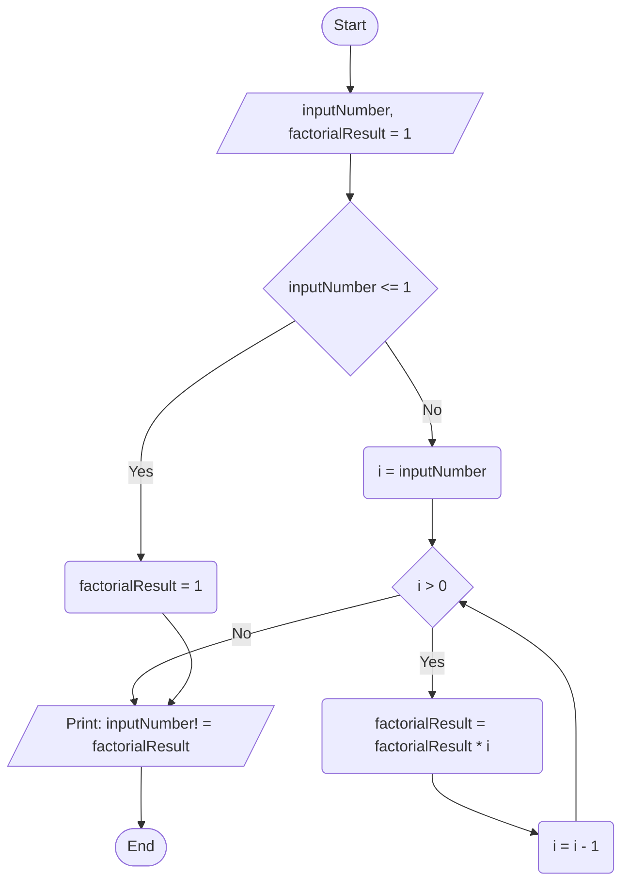

<div align="center">

  🇧🇷 **[Versão em Português](README.pt-BR.md)**
  <br>

  # ❗ Factorial Calculator (`FactorialAccumulator.ts`)

</div>

> **Origin:** Class 05 (`for` Loop, Terminal Input, and Functions Intro)  
> **Topic:** Multiplicative Accumulator (`n!`) and Comparing Three `for` Loop Directions

---

## 🎯 Problem Statement

In this exercise, I wrote a factorial calculator (`n!`) comparing three different `for` loop styles: the professor's descending loop (`n` down to `1`), my ascending loop (`1` up to `n`), and a second approach I tried in class multiplying by `(inputNumber - i)` starting at `i = 0`.

---

## 📊 Flowchart (ISO / ANSI)



---

## 🧪 Desk Checking (RAM Memory Trace)

Simulation for input `inputNumber = 4` (Option 1 - Descending approach):

| Iteration `i` | `inputNumber` | Condition (`i > 0`) | `factorialResult` (Accumulated) |
| :---: | :---: | :---: | :---: |
| **Init** | `4` | - | `1` |
| **`i = 4`** | `4` | `true` | `1 * 4 = 4` |
| **`i = 3`** | `4` | `true` | `4 * 3 = 12` |
| **`i = 2`** | `4` | `true` | `12 * 2 = 24` |
| **`i = 1`** | `4` | `true` | `24 * 1 = 24` |
| **`i = 0`** | `4` | `false` | *(Loop terminates with 24)* |

---

## 💻 Source Code

The full implementation is available in [FactorialAccumulator.ts](FactorialAccumulator.ts).

---

## 🖥️ Terminal Output

```text
==================================================
              Factorial Calculator
==================================================
1 - Descending repetition (Professor's approach)
2 - Ascending repetition (My first approach)
3 - Subtraction iteration (My second approach)

Processing 5!:
5
20
60
120
120

Final result of 5! = 120
==================================================
```

---

## 💡 Key Concepts Applied

- **Initializing at `1`:** A multiplication accumulator has to start at `1` (starting at `0` would keep the result at `0` forever).
- **Three Loop Strategies:**
  - **1 - Descending (Professor):** Loops from `inputNumber` down to `1` (`i--`).
  - **2 - Ascending (My 1st try):** Loops from `1` up to `inputNumber` (`i++`).
  - **3 - Offset Subtraction (My 2nd try):** Loops from `0` to `< inputNumber`, multiplying by `(inputNumber - i)`.

---

## 🚀 How to Run

```bash
# Direct execution via tsx
npx tsx src/08-factorial-accumulator/FactorialAccumulator.ts
```
