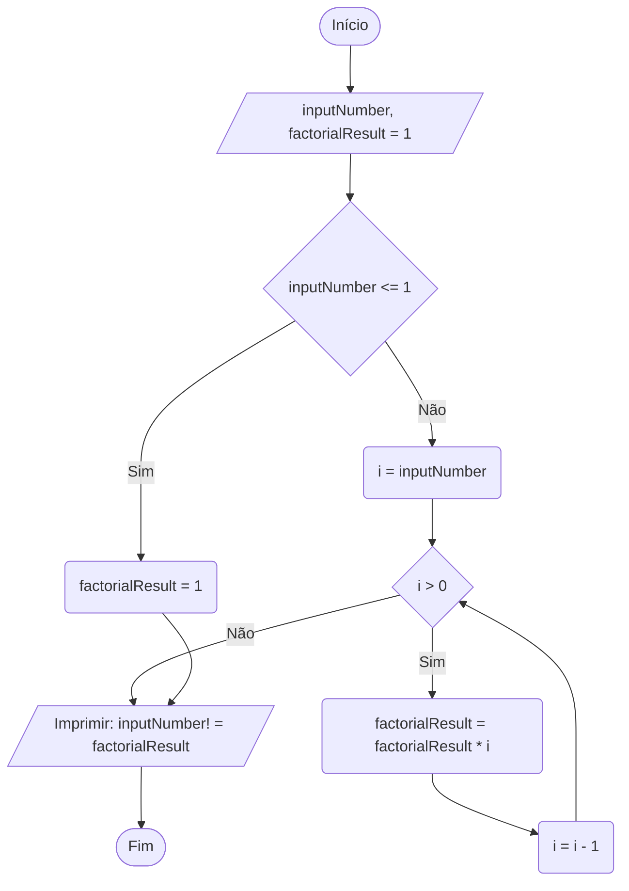

<div align="center">

  🇺🇸 **[English Version](README.md)**
  <br>

  # ❗ Cálculo de Fatorial (`FactorialAccumulator.ts`)

</div>

---

## 🎯 Enunciado

Calcular o fatorial de um número inteiro não-negativo ($n!$), comparando a repetição decrescente ensinada pelo professor ($n$ até $1$) com a repetição crescente que desenvolvi em aula ($1$ até $n$) e a minha alternativa com subtração direta ($(inputNumber - i)$ começando em $i = 0$).

---

## 📊 Fluxograma (Norma ISO / ANSI)



---

## 🧪 Teste de Mesa (Rastreamento na Memória RAM)

Simulação para a entrada `inputNumber = 4` (Opção 1 - Abordagem Decrescente):

| Iteração `i` | `inputNumber` | Condição (`i > 0`) | `factorialResult` (Acumulado) |
| :---: | :---: | :---: | :---: |
| **Início** | `4` | - | `1` |
| **`i = 4`** | `4` | `true` | `1 * 4 = 4` |
| **`i = 3`** | `4` | `true` | `4 * 3 = 12` |
| **`i = 2`** | `4` | `true` | `12 * 2 = 24` |
| **`i = 1`** | `4` | `true` | `24 * 1 = 24` |
| **`i = 0`** | `4` | `false` | *(Repetição encerra com resultado 24)* |

---

## 💻 Código Fonte

A implementação está disponível diretamente em [`FactorialAccumulator.ts`](FactorialAccumulator.ts).

---

## 🖥️ Saída no Terminal

```text
==================================================
              Factorial Calculator
==================================================
1 - Descending repetition (Professor's approach)
2 - Ascending repetition (My first approach)
3 - Subtraction iteration (My second approach)

Processing 5!:
5
20
60
120
120

Final result of 5! = 120
==================================================
```

---

## 💡 Conceitos Aplicados

- **Acumulador Multiplicativo:** Variáveis que acumulam multiplicações sucessivas devem ser inicializadas com `1` (elemento neutro da multiplicação).
- **Abordagens Comparadas:**
  - **1 - Decrescente (Professor):** Itera de `inputNumber` até `1` decrementando com `i--`, calculando `factorialResult *= i`.
  - **2 - Crescente (Meu 1º jeito):** Itera de `1` até `inputNumber` incrementando com `i++`, calculando `factorialResult *= i`.
  - **3 - Com Subtração (Meu 2º jeito):** Itera de `0` até `< inputNumber`, acumulando `factorialResult *= (inputNumber - i)`.

---

## 🚀 Como Executar

```bash
# Execução direta via tsx
npx tsx src/08-factorial-accumulator/FactorialAccumulator.ts
```
