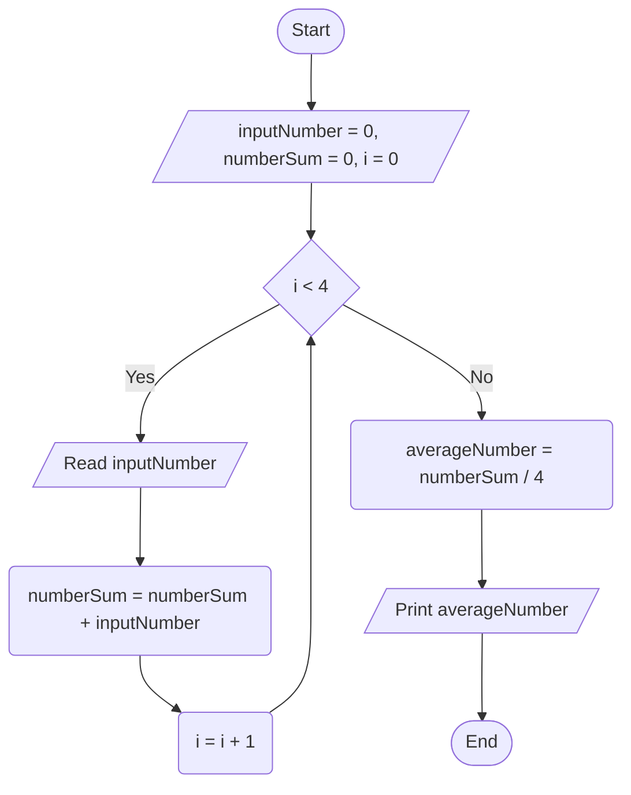

<div align="center">

  🇧🇷 **[Versão em Português](README.pt-BR.md)**
  <br>

  # 📊 Average of 4 Grades (`FourGradesAverage.ts`)

</div>

> **Origin:** Class 06 (`for` Loop, Modulo, Scope, and `break`)  
> **Topic:** Accumulator Variables, Variable Scope, and Console Desk Checking

---

## 🎯 Problem Statement

In this exercise, I wrote a program that reads 4 student grades inside a `for` loop, adds them up into a single accumulator variable (`numberSum`), and prints the final average. Instead of creating four separate grade variables, I reused one input variable (`inputNumber`) at every step. I also added an option to print the variable values before each prompt, reproducing the terminal desk check we practiced in class.

---

## 📊 Flowchart (ISO / ANSI)



---

## 🧪 Desk Checking (RAM Memory Trace)

Simulation for inputs `7`, `8`, `8`, and `6`:

| Iteration `i` | Condition (`i < 4`) | `inputNumber` | `numberSum` | `averageNumber` |
| :---: | :---: | :---: | :---: | :---: |
| **Init** | - | `0` | `0` | `0` |
| **`i = 0`** | `true` | `7` | `7` | `0` |
| **`i = 1`** | `true` | `8` | `15` | `0` |
| **`i = 2`** | `true` | `8` | `23` | `0` |
| **`i = 3`** | `true` | `6` | `29` | `0` |
| **`i = 4`** | `false` | `6` | `29` | `7.25` |

---

## 💻 Source Code

The full implementation is available in [FourGradesAverage.ts](FourGradesAverage.ts).

---

## 🖥️ Terminal Output

```text
==================================================
           Average of 4 Grades (for)
==================================================
1 - Standard calculation
2 - With desk-check trace in console
Choose an option (1 or 2): 2
Step 1 -> Average: 0; Sum: 0; Last grade: 0
Enter grade 1: 7
Step 2 -> Average: 0; Sum: 7; Last grade: 7
Enter grade 2: 8
Step 3 -> Average: 0; Sum: 15; Last grade: 8
Enter grade 3: 8
Step 4 -> Average: 0; Sum: 23; Last grade: 8
Enter grade 4: 6

Total sum: 29
The average is: 7.25
==================================================
```

---

## 💡 Key Concepts Applied

- **Accumulator Pattern:** Keeping `numberSum` outside the loop so each new grade adds onto the previous total (`numberSum += inputNumber`).
- **Local vs. Outer Scope:** The loop counter `i` only exists inside the `for` block, while `numberSum` and `averageNumber` stay accessible after the loop ends.
- **Console Desk Checking:** Printing intermediate values inside the loop makes it easy to inspect how variables change at each iteration.

---

## 🚀 How to Run

```bash
# Direct execution via tsx
npx tsx src/09-four-grades-average/FourGradesAverage.ts
```
