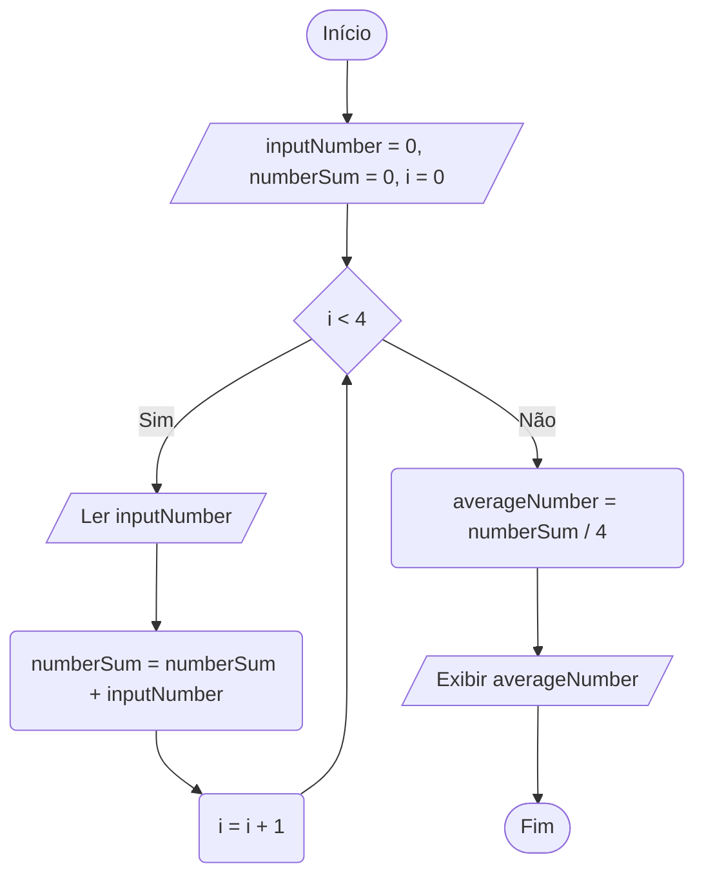

<div align="center">

  🇺🇸 **[English Version](README.md)**
  <br>

  # 📊 Média de 4 Notas (`FourGradesAverage.ts`)

</div>

> **Origem:** Aula 06 (Repetição com `for`, Módulo, Escopo e `break`)  
> **Tópico:** Variável Acumuladora, Escopo de Variável e Teste de Mesa no Console

---

## 🎯 Enunciado do Problema

Neste exercício, escrevi um programa que lê 4 notas dentro de um `for`, acumula a soma em uma única variável (`numberSum`) e calcula a média final. Em vez de declarar quatro variáveis isoladas para as notas, reutilizei uma só variável de entrada (`inputNumber`) a cada rodada. Também coloquei uma opção para exibir os valores das variáveis antes de cada leitura, reproduzindo o teste de mesa no console que fizemos em aula.

---

## 📊 Fluxograma (ISO / ANSI)



---

## 🧪 Teste de Mesa (Rastreamento em Memória)

Simulação para as entradas `7`, `8`, `8` e `6`:

| Iteração `i` | Condição (`i < 4`) | `inputNumber` | `numberSum` | `averageNumber` |
| :---: | :---: | :---: | :---: | :---: |
| **Início** | - | `0` | `0` | `0` |
| **`i = 0`** | `true` | `7` | `7` | `0` |
| **`i = 1`** | `true` | `8` | `15` | `0` |
| **`i = 2`** | `true` | `8` | `23` | `0` |
| **`i = 3`** | `true` | `6` | `29` | `0` |
| **`i = 4`** | `false` | `6` | `29` | `7.25` |

---

## 💻 Código-Fonte

O código completo está em [FourGradesAverage.ts](FourGradesAverage.ts).

---

## 🖥️ Saída no Terminal

```text
==================================================
           Average of 4 Grades (for)
==================================================
1 - Standard calculation
2 - With desk-check trace in console
Choose an option (1 or 2): 2
Step 1 -> Average: 0; Sum: 0; Last grade: 0
Enter grade 1: 7
Step 2 -> Average: 0; Sum: 7; Last grade: 7
Enter grade 2: 8
Step 3 -> Average: 0; Sum: 15; Last grade: 8
Enter grade 3: 8
Step 4 -> Average: 0; Sum: 23; Last grade: 8
Enter grade 4: 6

Total sum: 29
The average is: 7.25
==================================================
```

---

## 💡 Principais Conceitos Aplicados

- **Padrão Acumulador:** Manter `numberSum` fora do bloco `for` para que cada nova nota seja somada ao total anterior (`numberSum += inputNumber`).
- **Escopo Local vs. Externo:** O contador `i` só existe dentro do `for`, enquanto `numberSum` e `averageNumber` continuam acessíveis após o término das repetições.
- **Teste de Mesa no Console:** Imprimir os valores intermediários durante a execução ajuda a conferir como cada variável muda passo a passo.

---

## 🚀 Como Executar

```bash
# Execução direta via tsx
npx tsx src/09-four-grades-average/FourGradesAverage.ts
```
