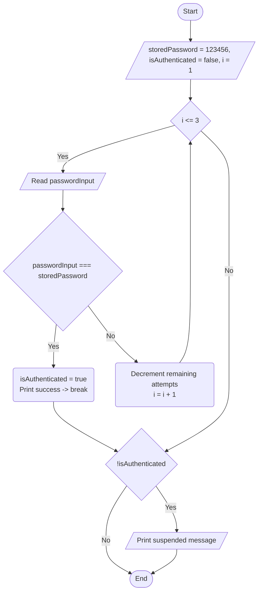

<div align="center">

  🇧🇷 **[Versão em Português](README.pt-BR.md)**
  <br>

  # 🔐 Password Check with 3 Attempts (`PasswordAttempts.ts`)

</div>

> **Origin:** Class 06 (`for` Loop, Modulo, Scope, and `break`)  
> **Topic:** Early Loop Exit (`break`), Attempt Counter, and Boolean Control Flag

---

## 🎯 Problem Statement

In this exercise, I wrote a password validation program using a `for` loop where the user has 3 chances to type the right password (`123456`). If the user gets it right, the program prints a confirmation message and stops immediately with `break`. In my first versions during class, the failure message after the loop still ran even after a successful login, so I added a boolean flag (`isAuthenticated`) to display the suspension message only when all 3 attempts fail.

---

## 📊 Flowchart (ISO / ANSI)



---

## 🧪 Desk Checking (RAM Memory Trace)

Simulation where the user fails the first attempt (`111111`) and succeeds on the second (`123456`):

| Iteration `i` | `passwordInput` | Match (`=== 123456`) | `isAuthenticated` | Action |
| :---: | :---: | :---: | :---: | :--- |
| **Init** | `0` | - | `false` | Ready |
| **`i = 1`** | `111111` | `false` | `false` | Prints `2 attempt(s) left` |
| **`i = 2`** | `123456` | `true` | `true` | Prints success and runs `break` |
| **After loop** | `123456` | - | `true` | Skips suspension message |

---

## 💻 Source Code

The full implementation is available in [PasswordAttempts.ts](PasswordAttempts.ts).

---

## 🖥️ Terminal Output

```text
==================================================
          Password Check (3 Attempts)
==================================================
Enter the password: 111111
Incorrect password! You have 2 attempt(s) left.

Enter the password: 123456

Correct password! Access granted.
==================================================
```

---

## 💡 Key Concepts Applied

- **Early Exit with `break`:** Stops the `for` loop immediately once the password matches, avoiding extra prompts.
- **Control Flag (`isAuthenticated`):** Because `break` only exits the loop (not the whole script), the boolean flag lets the code after the loop know whether the user succeeded or ran out of attempts.
- **Template Strings:** Using backticks and `${remainingAttempts}` to print how many tries remain cleanly.

---

## 🚀 How to Run

```bash
# Direct execution via tsx
npx tsx src/10-password-attempts/PasswordAttempts.ts
```
