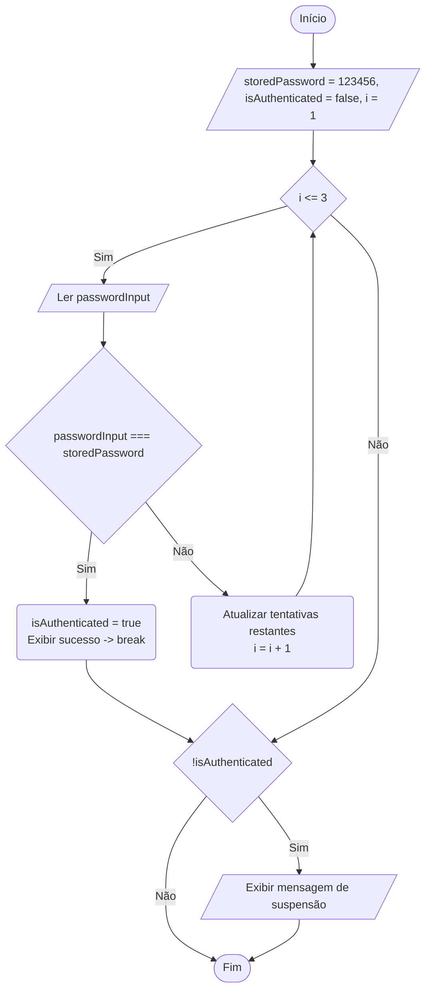

<div align="center">

  🇺🇸 **[English Version](README.md)**
  <br>

  # 🔐 Verificação de Senha com 3 Tentativas (`PasswordAttempts.ts`)

</div>

> **Origem:** Aula 06 (Repetição com `for`, Módulo, Escopo e `break`)  
> **Tópico:** Saída Antecipada com `break`, Contagem de Tentativas e Flag Booleana

---

## 🎯 Enunciado do Problema

Neste exercício, escrevi um programa de validação de senha com `for` em que o usuário tem 3 chances para digitar a senha correta (`123456`). Se acertar, o programa libera o acesso e interrompe as repetições com `break`. Nas minhas primeiras versões feitas em sala, a mensagem de bloqueio depois do `for` ainda aparecia mesmo quando eu acertava a senha, então adicionei uma flag booleana (`isAuthenticated`) para exibir a suspensão só quando todas as 3 tentativas falham.

---

## 📊 Fluxograma (ISO / ANSI)



---

## 🧪 Teste de Mesa (Rastreamento em Memória)

Simulação em que o usuário erra na primeira tentativa (`111111`) e acerta na segunda (`123456`):

| Iteração `i` | `passwordInput` | Acerto (`=== 123456`) | `isAuthenticated` | Ação |
| :---: | :---: | :---: | :---: | :--- |
| **Início** | `0` | - | `false` | Preparado |
| **`i = 1`** | `111111` | `false` | `false` | Exibe `2 attempt(s) left` |
| **`i = 2`** | `123456` | `true` | `true` | Exibe sucesso e executa `break` |
| **Após o `for`** | `123456` | - | `true` | Ignora mensagem de suspensão |

---

## 💻 Código-Fonte

O código completo está em [PasswordAttempts.ts](PasswordAttempts.ts).

---

## 🖥️ Saída no Terminal

```text
==================================================
          Password Check (3 Attempts)
==================================================
Enter the password: 111111
Incorrect password! You have 2 attempt(s) left.

Enter the password: 123456

Correct password! Access granted.
==================================================
```

---

## 💡 Principais Conceitos Aplicados

- **Parada Antecipada com `break`:** Encerra a repetição imediatamente ao encontrar a senha correta, sem gastar as tentativas restantes.
- **Flag de Controle (`isAuthenticated`):** Como o `break` sai apenas do `for` (e não do programa inteiro), a flag booleana permite saber fora do bloco se houve acerto ou bloqueio.
- **Template Strings:** Uso de crases com `${remainingAttempts}` para montar a mensagem de tentativas restantes de forma direta.

---

## 🚀 Como Executar

```bash
# Execução direta via tsx
npx tsx src/10-password-attempts/PasswordAttempts.ts
```
