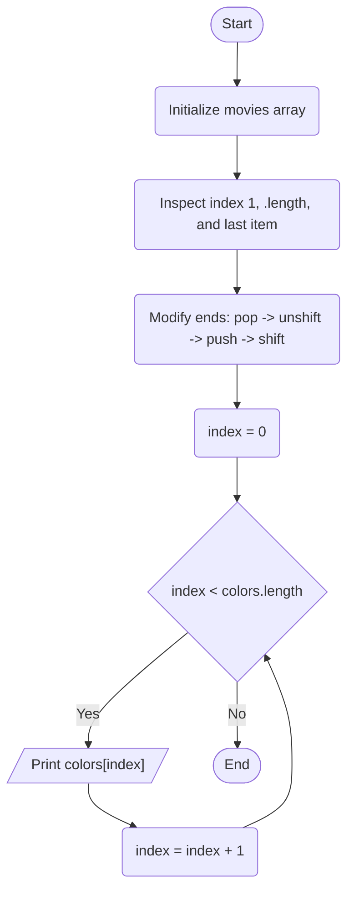

<div align="center">

  🇧🇷 **[Versão em Português](README.pt-BR.md)**
  <br>

  # 📦 Array Indexing and Core Methods (`ArrayMethodsDemo.ts`)

</div>

> **Origin:** Class 07 (Vectors, Matrices, and Array Manipulation)  
> **Topic:** Typed Arrays (`string[]`), Zero-Based Indexing, `push`/`pop`/`shift`/`unshift`, and `.length` Traversal

---

## 🎯 Problem Statement

In this exercise, I practiced creating typed arrays in TypeScript (`string[]`), reading elements by their zero-based index, accessing the last element with `movies[movies.length - 1]`, and modifying both ends of the list using `pop()`, `unshift()`, `push()`, and `shift()`. At the end, I traversed a `colors` array using `.length` so the loop works regardless of how many items are in the array.

---

## 📊 Flowchart (ISO / ANSI)



---

## 🧪 Desk Checking (RAM Memory Trace)

State of `movies` across each method call:

| Operation | Return Value | `movies` Array After Operation |
| :--- | :--- | :--- |
| **Initial** | - | `["The Lord of the Rings", "A Clockwork Orange", "The Matrix", "Gandhi"]` |
| **`movies.pop()!`** | `"Gandhi"` | `["The Lord of the Rings", "A Clockwork Orange", "The Matrix"]` |
| **`movies.unshift("Gandhi")`** | `4` (new length) | `["Gandhi", "The Lord of the Rings", "A Clockwork Orange", "The Matrix"]` |
| **`movies.push("Interstellar")`** | `5` (new length) | `["Gandhi", "The Lord of the Rings", "A Clockwork Orange", "The Matrix", "Interstellar"]` |
| **`movies.shift()`** | `"Gandhi"` | `["The Lord of the Rings", "A Clockwork Orange", "The Matrix", "Interstellar"]` |

---

## 💻 Source Code

The full implementation is available in [ArrayMethodsDemo.ts](ArrayMethodsDemo.ts).

---

## 🖥️ Terminal Output

```text
==================================================
       Array Indexing and Core Methods Demo
==================================================
Initial list: [
  'The Lord of the Rings',
  'A Clockwork Orange',
  'The Matrix',
  'Gandhi'
]
Element at index 1: A Clockwork Orange
Total items (.length): 4
Last element (movies[movies.length - 1]): Gandhi

After pop(): removed -> Gandhi
Movies now: [ 'The Lord of the Rings', 'A Clockwork Orange', 'The Matrix' ]

After unshift('Gandhi'): [
  'Gandhi',
  'The Lord of the Rings',
  'A Clockwork Orange',
  'The Matrix'
]

After push('Interstellar'): [
  'Gandhi',
  'The Lord of the Rings',
  'A Clockwork Orange',
  'The Matrix',
  'Interstellar'
]

After shift(): [
  'The Lord of the Rings',
  'A Clockwork Orange',
  'The Matrix',
  'Interstellar'
]

Size-agnostic traversal (colors):
The element at index 0 is red.
The element at index 1 is green.
The element at index 2 is blue.

Control flag example -> isLogged: true
==================================================
```

---

## 💡 Key Concepts Applied

- **Zero-Based Indexing:** The first item is at index `0` and the last item is always at `array.length - 1`.
- **Plural Naming Convention:** Naming collections in the plural (`movies`, `colors`) makes it obvious that the variable stores multiple items.
- **Manipulating Both Ends:** `push()` and `pop()` add or remove from the end of the array; `unshift()` and `shift()` add or remove from the start.
- **Size-Agnostic Iteration:** Using `index < colors.length` lets the `for` loop adapt automatically if items are added or removed.

---

## 🚀 How to Run

```bash
# Direct execution via tsx
npx tsx src/11-array-methods-demo/ArrayMethodsDemo.ts
```
