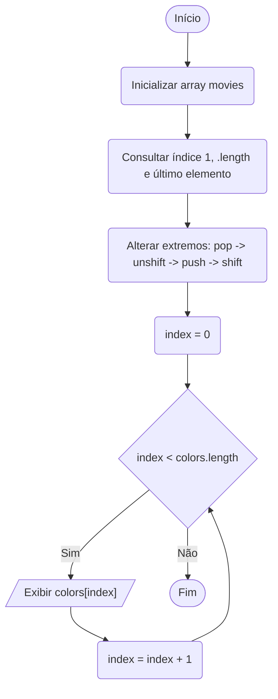

<div align="center">

  🇺🇸 **[English Version](README.md)**
  <br>

  # 📦 Indexação e Métodos de Arrays (`ArrayMethodsDemo.ts`)

</div>

> **Origem:** Aula 07 (Vetores, Matrizes e Manipulação de Arrays)  
> **Tópico:** Arrays Tipados (`string[]`), Índice Base 0, `push`/`pop`/`shift`/`unshift` e Leitura com `.length`

---

## 🎯 Enunciado do Problema

Neste exercício, pratiquei a criação de arrays tipados em TypeScript (`string[]`), o acesso a elementos por índice começando em zero, a leitura do último item com `movies[movies.length - 1]` e a modificação das duas extremidades da lista usando `pop()`, `unshift()`, `push()` e `shift()`. No final, percorri o array `colors` usando `.length` para que o `for` funcione com qualquer quantidade de itens.

---

## 📊 Fluxograma (ISO / ANSI)



---

## 🧪 Teste de Mesa (Rastreamento em Memória)

Estado do array `movies` após cada método:

| Operação | Retorno | Array `movies` Após a Operação |
| :--- | :--- | :--- |
| **Inicial** | - | `["The Lord of the Rings", "A Clockwork Orange", "The Matrix", "Gandhi"]` |
| **`movies.pop()!`** | `"Gandhi"` | `["The Lord of the Rings", "A Clockwork Orange", "The Matrix"]` |
| **`movies.unshift("Gandhi")`** | `4` (novo tamanho) | `["Gandhi", "The Lord of the Rings", "A Clockwork Orange", "The Matrix"]` |
| **`movies.push("Interstellar")`** | `5` (novo tamanho) | `["Gandhi", "The Lord of the Rings", "A Clockwork Orange", "The Matrix", "Interstellar"]` |
| **`movies.shift()`** | `"Gandhi"` | `["The Lord of the Rings", "A Clockwork Orange", "The Matrix", "Interstellar"]` |

---

## 💻 Código-Fonte

O código completo está em [ArrayMethodsDemo.ts](ArrayMethodsDemo.ts).

---

## 🖥️ Saída no Terminal

```text
==================================================
       Array Indexing and Core Methods Demo
==================================================
Initial list: [
  'The Lord of the Rings',
  'A Clockwork Orange',
  'The Matrix',
  'Gandhi'
]
Element at index 1: A Clockwork Orange
Total items (.length): 4
Last element (movies[movies.length - 1]): Gandhi

After pop(): removed -> Gandhi
Movies now: [ 'The Lord of the Rings', 'A Clockwork Orange', 'The Matrix' ]

After unshift('Gandhi'): [
  'Gandhi',
  'The Lord of the Rings',
  'A Clockwork Orange',
  'The Matrix'
]

After push('Interstellar'): [
  'Gandhi',
  'The Lord of the Rings',
  'A Clockwork Orange',
  'The Matrix',
  'Interstellar'
]

After shift(): [
  'The Lord of the Rings',
  'A Clockwork Orange',
  'The Matrix',
  'Interstellar'
]

Size-agnostic traversal (colors):
The element at index 0 is red.
The element at index 1 is green.
The element at index 2 is blue.

Control flag example -> isLogged: true
==================================================
```

---

## 💡 Principais Conceitos Aplicados

- **Indexação a Partir do Zero:** O primeiro elemento fica na posição `0` e o último sempre em `array.length - 1`.
- **Nomenclatura no Plural:** Nomear coleções no plural (`movies`, `colors`) deixa claro que a variável guarda vários itens.
- **Manipulação das Extremidades:** `push()` e `pop()` atuam no final do array; `unshift()` e `shift()` atuam no começo.
- **Repetição Agnóstica ao Tamanho:** Usar `index < colors.length` faz o `for` se adaptar automaticamente caso itens sejam inseridos ou removidos.

---

## 🚀 Como Executar

```bash
# Execução direta via tsx
npx tsx src/11-array-methods-demo/ArrayMethodsDemo.ts
```
