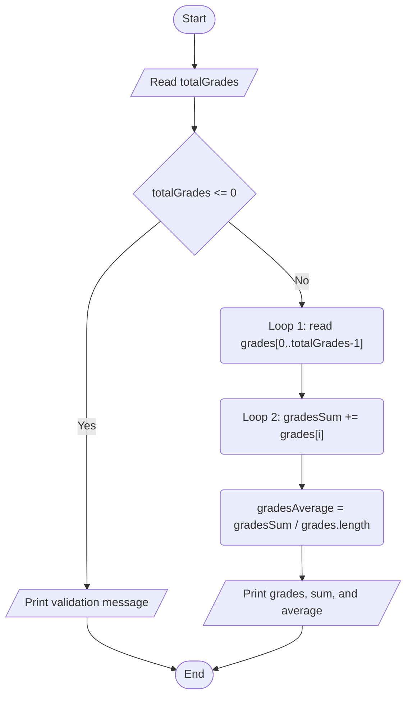

<div align="center">

  🇧🇷 **[Versão em Português](README.pt-BR.md)**
  <br>

  # 📈 Dynamic Grades Average (`DynamicGradesAverage.ts`)

</div>

> **Origin:** Class 07 (Vectors, Matrices, and Array Manipulation)  
> **Topic:** Typed Number Arrays (`number[]`), Dynamic Input Size, and Two-Loop Separation

---

## 🎯 Problem Statement

In class, the professor asked us to calculate the average of 5 grades using an array and a `for` loop. I decided to go one step further and let the user choose how many subjects they want to enter first. The program stores each grade in a `number[]` array in one `for` loop, sums everything in a second `for` loop using `.length`, and prints the average.

---

## 📊 Flowchart (ISO / ANSI)



---

## 🧪 Desk Checking (RAM Memory Trace)

Simulation for `totalGrades = 3` with grades `7`, `8.5`, and `9`:

| Phase | `i` | `grades` | `gradesSum` | `gradesAverage` |
| :--- | :---: | :--- | :---: | :---: |
| **Input Loop** | `0..2` | `[7, 8.5, 9]` | `0` | `0` |
| **Sum Loop** | `0` | `[7, 8.5, 9]` | `7` | `0` |
| **Sum Loop** | `1` | `[7, 8.5, 9]` | `15.5` | `0` |
| **Sum Loop** | `2` | `[7, 8.5, 9]` | `24.5` | `0` |
| **Division** | - | `[7, 8.5, 9]` | `24.5` | `8.17` |

---

## 💻 Source Code

The full implementation is available in [DynamicGradesAverage.ts](DynamicGradesAverage.ts).

---

## 🖥️ Terminal Output

```text
==================================================
        Dynamic Grades Average with Array
==================================================
Number of subjects: 3
Grade 1: 7
Grade 2: 8.5
Grade 3: 9

Recorded grades: [ 7, 8.5, 9 ]
Total sum: 24.5
The average is: 8.17
==================================================
```

---

## 💡 Key Concepts Applied

- **Dynamic Collection Size:** Asking for `totalGrades` first lets the same program work for 3, 5, or 10 subjects without editing the code.
- **Separation of Input and Processing:** The first `for` loop only fills the `grades` array, while the second `for` loop sums the values using `grades.length`.
- **Retaining Values in Memory:** Unlike the Class 06 exercise (which overwrote one variable), storing grades in an array allows displaying all recorded grades at the end.

---

## 🚀 How to Run

```bash
# Direct execution via tsx
npx tsx src/12-dynamic-grades-average/DynamicGradesAverage.ts
```
