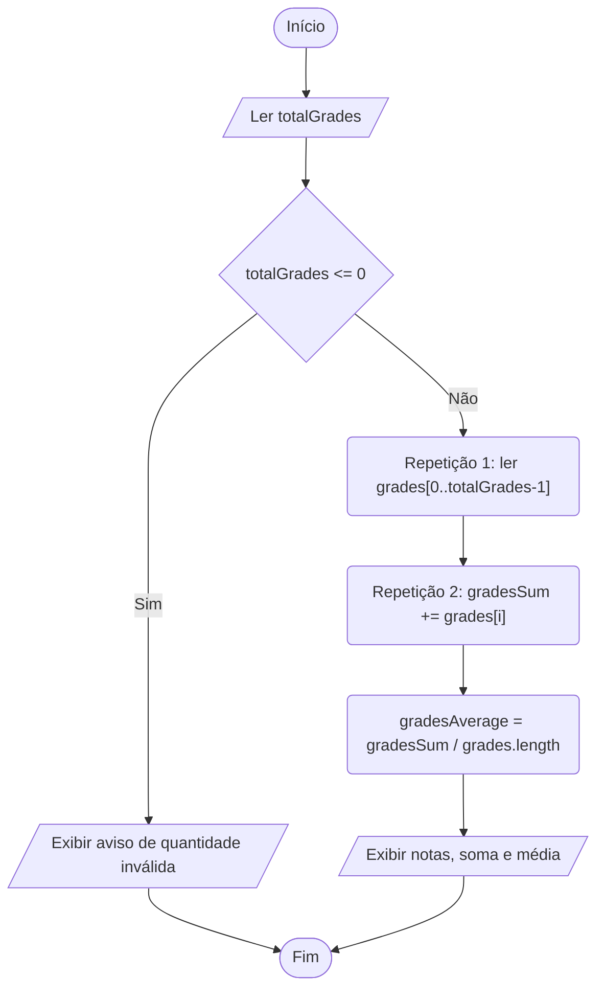

<div align="center">

  🇺🇸 **[English Version](README.md)**
  <br>

  # 📈 Média Dinâmica de Notas com Array (`DynamicGradesAverage.ts`)

</div>

> **Origem:** Aula 07 (Vetores, Matrizes e Manipulação de Arrays)  
> **Tópico:** Array Numérico Tipado (`number[]`), Quantidade Dinâmica e Separação de Responsabilidades

---

## 🎯 Enunciado do Problema

Em aula, o professor pediu para calcular a média de 5 notas usando vetor e `for`. Eu quis ir um passo além e deixar o usuário escolher primeiro quantas matérias deseja informar. O programa guarda cada nota no array `number[]` em um primeiro `for`, soma tudo em um segundo `for` usando `.length` e mostra a média final.

---

## 📊 Fluxograma (ISO / ANSI)



---

## 🧪 Teste de Mesa (Rastreamento em Memória)

Simulação para `totalGrades = 3` com as notas `7`, `8.5` e `9`:

| Etapa | `i` | `grades` | `gradesSum` | `gradesAverage` |
| :--- | :---: | :--- | :---: | :---: |
| **Leitura** | `0..2` | `[7, 8.5, 9]` | `0` | `0` |
| **Soma** | `0` | `[7, 8.5, 9]` | `7` | `0` |
| **Soma** | `1` | `[7, 8.5, 9]` | `15.5` | `0` |
| **Soma** | `2` | `[7, 8.5, 9]` | `24.5` | `0` |
| **Divisão** | - | `[7, 8.5, 9]` | `24.5` | `8.17` |

---

## 💻 Código-Fonte

O código completo está em [DynamicGradesAverage.ts](DynamicGradesAverage.ts).

---

## 🖥️ Saída no Terminal

```text
==================================================
        Dynamic Grades Average with Array
==================================================
Number of subjects: 3
Grade 1: 7
Grade 2: 8.5
Grade 3: 9

Recorded grades: [ 7, 8.5, 9 ]
Total sum: 24.5
The average is: 8.17
==================================================
```

---

## 💡 Principais Conceitos Aplicados

- **Quantidade Dinâmica:** Pedir `totalGrades` antes permite rodar o mesmo código para 3, 5 ou 10 matérias sem alterar nada no arquivo.
- **Separação entre Leitura e Processamento:** O primeiro `for` apenas coleta os valores no array `grades`, enquanto o segundo faz a soma usando `grades.length`.
- **Histórico em Memória:** Diferente do exercício da Aula 06 (que sobrescrevia a mesma variável), guardar tudo no array permite exibir todas as notas digitadas no final.

---

## 🚀 Como Executar

```bash
# Execução direta via tsx
npx tsx src/12-dynamic-grades-average/DynamicGradesAverage.ts
```
