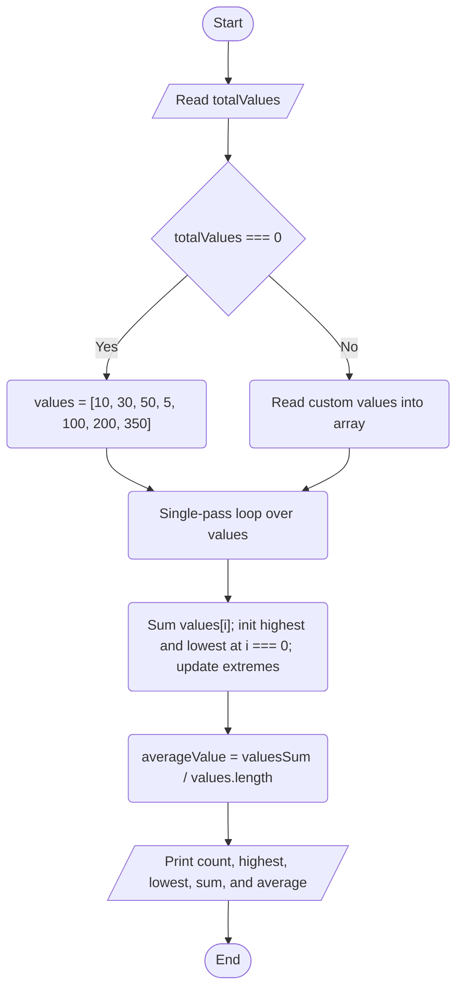

<div align="center">

  🇧🇷 **[Versão em Português](README.pt-BR.md)**
  <br>

  # 💰 Sales Extremes and Average (`SalesExtremesAnalysis.ts`)

</div>

> **Origin:** Class 08 (Array Manipulation and Finding Extremes)  
> **Topic:** Linear Search for Highest and Lowest Values, Single-Pass Aggregation, and `.toFixed(2)`

---

## 🎯 Problem Statement

In this exercise, I wrote a program to analyze a list of sales values. The user can type `0` to test with the default 7-sale dataset from class (`[10, 30, 50, 5, 100, 200, 350]`) or enter a custom quantity of values. In a single `for` pass over the array, the program computes the total sales count, accumulated sum, average formatted to two decimal places, highest sale, and lowest sale.

---

## 📊 Flowchart (ISO / ANSI)



---

## 🧪 Desk Checking (RAM Memory Trace)

Simulation using the default array `[10, 30, 50, 5, 100, 200, 350]`:

| `i` | `values[i]` | `valuesSum` | `highestValue` | `lowestValue` |
| :-: | :---: | :---: | :---: | :---: |
| `0` | `10` | `10` | `10` | `10` |
| `1` | `30` | `40` | `30` | `10` |
| `2` | `50` | `90` | `50` | `10` |
| `3` | `5` | `95` | `50` | `5` |
| `4` | `100` | `195` | `100` | `5` |
| `5` | `200` | `395` | `200` | `5` |
| `6` | `350` | `745` | `350` | `5` |

---

## 💻 Source Code

The full implementation is available in [SalesExtremesAnalysis.ts](SalesExtremesAnalysis.ts).

---

## 🖥️ Terminal Output

```text
==================================================
         Sales Extremes and Average
==================================================
How many sales values do you want to enter? (Enter 0 to use the 7 default values): 0

Sales dataset: [
   10,  30,  50, 5,
  100, 200, 350
]
Total sales count: 7
Highest sale: 350
Lowest sale: 5
Sum of sales: 745
Average sale: 106.43
==================================================
```

---

## 💡 Key Concepts Applied

- **Initializing Extremes Safely (`i === 0`):** If `lowestValue` stays at `0`, positive sales like `5` or `10` will never be smaller than `0`. Initializing both `lowestValue` and `highestValue` with `values[0]` on the first iteration fixes this edge case.
- **Single-Pass Aggregation:** Computing sum, highest value, and lowest value together in one traversal instead of running three separate loops.
- **Default Dataset Shortcut:** Letting the user press `0` loads the 7 class values immediately so it is faster to test changes.
- **Decimal Formatting:** Using `averageValue.toFixed(2)` to round the displayed average to two decimal places.

---

## 🚀 How to Run

```bash
# Direct execution via tsx
npx tsx src/13-sales-extremes-analysis/SalesExtremesAnalysis.ts
```
