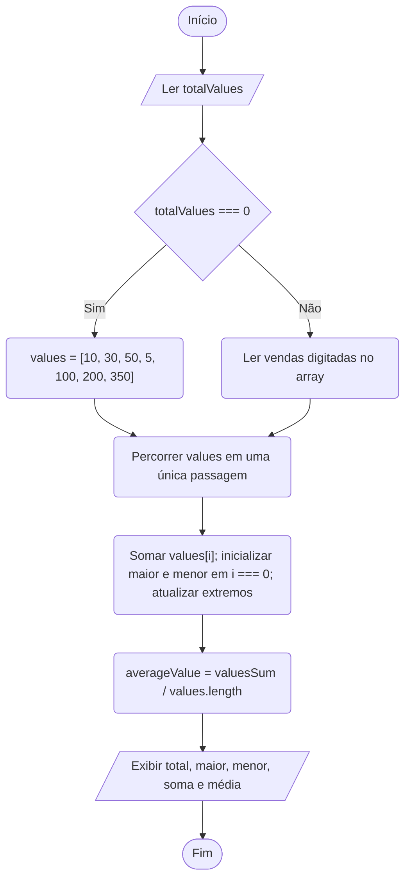

<div align="center">

  🇺🇸 **[English Version](README.md)**
  <br>

  # 💰 Análise de Vendas e Busca de Extremos (`SalesExtremesAnalysis.ts`)

</div>

> **Origem:** Aula 08 (Manipulação de Matrizes e Busca de Extremos)  
> **Tópico:** Busca Linear de Maior e Menor Valor, Agregação em Passagem Única e `.toFixed(2)`

---

## 🎯 Enunciado do Problema

Neste exercício, escrevi um programa para analisar um conjunto de valores de vendas. O usuário pode digitar `0` para testar direto com os 7 valores padrão da aula (`[10, 30, 50, 5, 100, 200, 350]`) ou informar uma quantidade própria de vendas. Em uma única passagem pelo array com `for`, o código calcula o total de vendas, a soma acumulada, a média com duas casas decimais, o maior valor e o menor valor.

---

## 📊 Fluxograma (ISO / ANSI)



---

## 🧪 Teste de Mesa (Rastreamento em Memória)

Simulação usando o array padrão `[10, 30, 50, 5, 100, 200, 350]`:

| `i` | `values[i]` | `valuesSum` | `highestValue` | `lowestValue` |
| :-: | :---: | :---: | :---: | :---: |
| `0` | `10` | `10` | `10` | `10` |
| `1` | `30` | `40` | `30` | `10` |
| `2` | `50` | `90` | `50` | `10` |
| `3` | `5` | `95` | `50` | `5` |
| `4` | `100` | `195` | `100` | `5` |
| `5` | `200` | `395` | `200` | `5` |
| `6` | `350` | `745` | `350` | `5` |

---

## 💻 Código-Fonte

O código completo está em [SalesExtremesAnalysis.ts](SalesExtremesAnalysis.ts).

---

## 🖥️ Saída no Terminal

```text
==================================================
         Sales Extremes and Average
==================================================
How many sales values do you want to enter? (Enter 0 to use the 7 default values): 0

Sales dataset: [
   10,  30,  50, 5,
  100, 200, 350
]
Total sales count: 7
Highest sale: 350
Lowest sale: 5
Sum of sales: 745
Average sale: 106.43
==================================================
```

---

## 💡 Principais Conceitos Aplicados

- **Inicialização Segura dos Extremos (`i === 0`):** Se `lowestValue` ficar zerado em `0`, valores positivos como `5` ou `10` nunca serão menores que `0`. Inicializar tanto `lowestValue` quanto `highestValue` com `values[0]` na primeira iteração resolve esse problema.
- **Agregação em Passagem Única:** Calcular soma, maior valor e menor valor juntos no mesmo `for`, evitando percorrer o array três vezes.
- **Atalho com Dados Padrão:** Permitir digitar `0` para carregar os 7 valores da aula agiliza os testes no terminal.
- **Formatação Decimal:** Uso de `averageValue.toFixed(2)` para exibir a média com duas casas decimais.

---

## 🚀 Como Executar

```bash
# Execução direta via tsx
npx tsx src/13-sales-extremes-analysis/SalesExtremesAnalysis.ts
```
