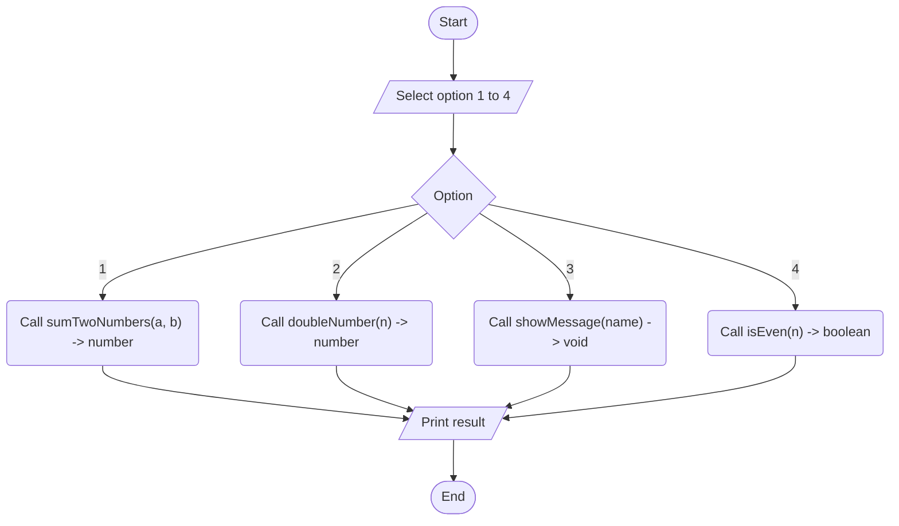

<div align="center">

  🇧🇷 **[Versão em Português](README.pt-BR.md)**
  <br>

  # 🧩 TypeScript Functions Practice (`FunctionsPractice.ts`)

</div>

> **Origin:** Class 09 (Functions, Scope, Signatures, and Modularization)  
> **Topic:** Function Signatures, Local vs. Global Scope, `void` Return, and Boolean Predicates

---

## 🎯 Problem Statement

In this exercise, I grouped the four introductory function problems we practiced in class into a single menu:
1. `sumTwoNumbers(firstNumber: number, secondNumber: number): number` to add two numbers.
2. `doubleNumber(enteredNumber: number): number` to return double a given number without printing inside the function.
3. `showMessage(enteredName: string): void` to display a greeting without returning a value.
4. `isEven(enteredNumber: number): boolean` to check if a number is even or odd returning a boolean instead of a string. (In class I accidentally inverted `true` and `false` on the first draft, so here I fixed `remainder === 0` to return `true`.)

---

## 📊 Flowchart (ISO / ANSI)



---

## 🧪 Desk Checking (RAM Memory Trace)

Trace for Option 4 (`isEven`) with `numberToProcess = 8`:

| Step | Scope | Variable | Value |
| :--- | :--- | :--- | :---: |
| **Call** | Global -> Local | `enteredNumber` | `8` |
| **Modulo** | Local (`isEven`) | `remainder` (`8 % 2`) | `0` |
| **Branch** | Local (`isEven`) | `isEvenNumber` | `true` |
| **Return** | Global | `isEvenResult` | `true` |
| **Output** | Global | Terminal | `"Even."` |

---

## 💻 Source Code

The full implementation is available in [FunctionsPractice.ts](FunctionsPractice.ts).

---

## 🖥️ Terminal Output

```text
==================================================
         TypeScript Functions Practice
==================================================
1 - Sum two numbers (number return)
2 - Double a number (number return)
3 - Display greeting (void return)
4 - Check even or odd (boolean return)
Choose an exercise (1-4): 4
Enter a number to check if it is even or odd: 8
Even.
==================================================
```

---

## 💡 Key Concepts Applied

- **Function Signature:** Declaring the function name, parameter types, and return type (`(a: number, b: number): number`) defines the exact contract for callers.
- **Local vs. Global Scope:** Variables declared inside a function stay encapsulated there, protecting them from outside changes. I also avoided naming local variables the same as outer variables.
- **Immediate Exit with `return`:** Any line written after a `return` statement inside the same path is ignored.
- **`void` vs. Value Return:** `showMessage` uses `void` because it only prints text, while `doubleNumber` returns a `number` so the caller decides how to display or reuse it.
- **Returning `boolean` for Two-Option Checks:** Replacing `evenOrOdd(): string` with `isEven(): boolean` keeps the check reusable and leaves message formatting outside the function.

---

## 🚀 How to Run

```bash
# Direct execution via tsx
npx tsx src/14-functions-practice/FunctionsPractice.ts
```
