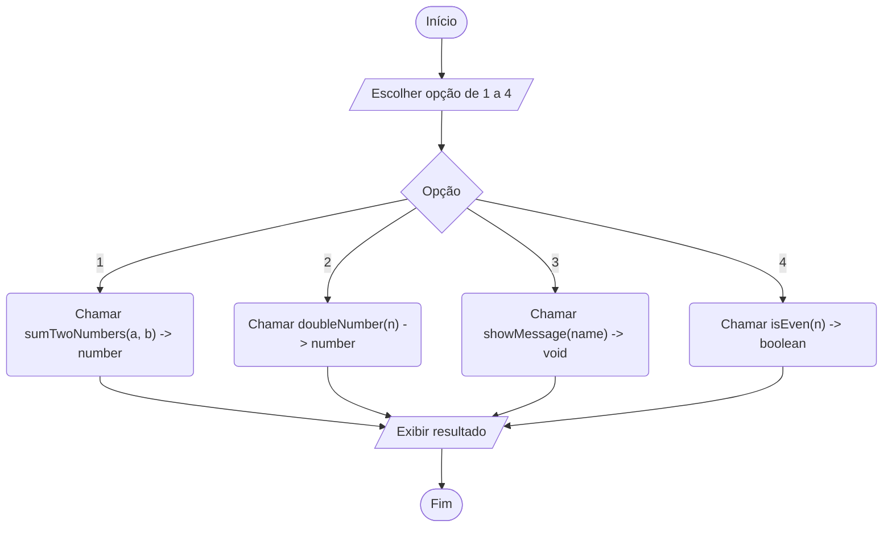

<div align="center">

  🇺🇸 **[English Version](README.md)**
  <br>

  # 🧩 Prática de Funções em TypeScript (`FunctionsPractice.ts`)

</div>

> **Origem:** Aula 09 (Funções, Escopo, Assinatura e Modularização)  
> **Tópico:** Assinatura de Função, Escopo Local vs. Global, Retorno `void` e Retorno Booleano

---

## 🎯 Enunciado do Problema

Neste exercício, reuni em um só menu os quatro exercícios iniciais de funções que praticamos em sala:
1. `sumTwoNumbers(firstNumber: number, secondNumber: number): number` para somar dois números.
2. `doubleNumber(enteredNumber: number): number` para calcular o dobro sem colocar `console.log` dentro da função.
3. `showMessage(enteredName: string): void` para exibir uma saudação sem retornar valor.
4. `isEven(enteredNumber: number): boolean` para verificar se um número é par ou ímpar retornando booleano em vez de texto. (Na lousa acabei invertendo `true` e `false` no primeiro rascunho, então aqui já deixei `remainder === 0` retornando `true`.)

---

## 📊 Fluxograma (ISO / ANSI)



---

## 🧪 Teste de Mesa (Rastreamento em Memória)

Rastreamento da Opção 4 (`isEven`) com `numberToProcess = 8`:

| Etapa | Escopo | Variável | Valor |
| :--- | :--- | :--- | :---: |
| **Chamada** | Global -> Local | `enteredNumber` | `8` |
| **Resto** | Local (`isEven`) | `remainder` (`8 % 2`) | `0` |
| **Condição** | Local (`isEven`) | `isEvenNumber` | `true` |
| **Retorno** | Global | `isEvenResult` | `true` |
| **Saída** | Global | Terminal | `"Even."` |

---

## 💻 Código-Fonte

O código completo está em [FunctionsPractice.ts](FunctionsPractice.ts).

---

## 🖥️ Saída no Terminal

```text
==================================================
         TypeScript Functions Practice
==================================================
1 - Sum two numbers (number return)
2 - Double a number (number return)
3 - Display greeting (void return)
4 - Check even or odd (boolean return)
Choose an exercise (1-4): 4
Enter a number to check if it is even or odd: 8
Even.
==================================================
```

---

## 💡 Principais Conceitos Aplicados

- **Assinatura da Função:** Declarar o nome, os tipos dos parâmetros e o tipo de retorno (`(a: number, b: number): number`) deixa claro o contrato da função.
- **Escopo Local vs. Global:** Variáveis criadas dentro da função ficam encapsuladas e protegidas de alterações externas. Também evitei repetir o mesmo nome entre variáveis locais e globais.
- **Saída Imediata com `return`:** Qualquer instrução escrita depois do `return` no mesmo caminho é ignorada.
- **Retorno `void` vs. Valor:** `showMessage` usa `void` porque só imprime na tela, enquanto `doubleNumber` devolve o `number` para quem chamou decidir o que fazer com ele.
- **Booleano para Duas Opções:** Trocar `evenOrOdd(): string` por `isEven(): boolean` deixa a verificação reutilizável e separa a lógica da mensagem exibida.

---

## 🚀 Como Executar

```bash
# Execução direta via tsx
npx tsx src/14-functions-practice/FunctionsPractice.ts
```
