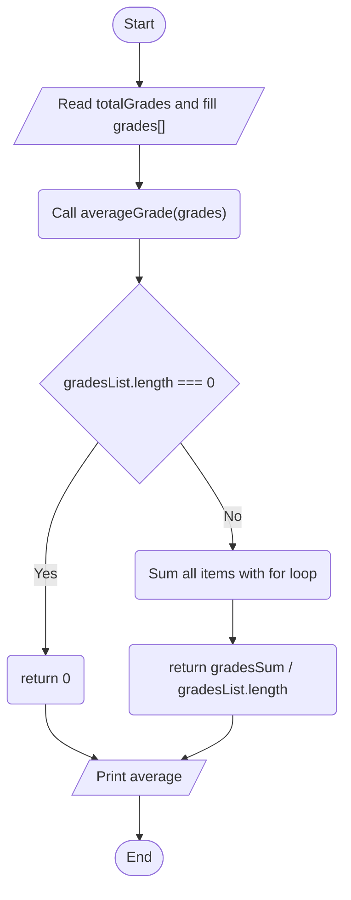

<div align="center">

  🇧🇷 **[Versão em Português](README.pt-BR.md)**
  <br>

  # 🎯 Modular Grades Average (`ModularGradesAverage.ts`)

</div>

> **Origin:** Class 09 (Functions, Scope, Signatures, and Modularization)  
> **Topic:** Passing Arrays as Parameters (`number[]`), Guard Clause, and `if`/`for` Modularization

---

## 🎯 Problem Statement

In this final exercise from Class 09, the professor asked us to compute the average of `N` grades stored in an array, delegating the calculation itself to a dedicated function and using only `if` and `for`. I wrote `averageGrade(gradesList: number[]): number` with an early guard check (`if (gradesList.length === 0) return 0`) so an empty array never causes a `0 / 0` (`NaN`) division.

---

## 📊 Flowchart (ISO / ANSI)



---

## 🧪 Desk Checking (RAM Memory Trace)

Simulation inside `averageGrade([8, 9, 7])`:

| Step | `i` | `gradesList[i]` | `gradesSum` | Return |
| :--- | :---: | :---: | :---: | :---: |
| **Guard check** | - | `length = 3` (not 0) | `0` | - |
| **Iteration 0** | `0` | `8` | `8` | - |
| **Iteration 1** | `1` | `9` | `17` | - |
| **Iteration 2** | `2` | `7` | `24` | - |
| **Division** | - | - | `24` | `24 / 3 = 8` |

---

## 💻 Source Code

The full implementation is available in [ModularGradesAverage.ts](ModularGradesAverage.ts).

---

## 🖥️ Terminal Output

```text
==================================================
       Modular Grades Average with Function
==================================================
How many grades do you want to enter? 3
Grade 1: 8
Grade 2: 9
Grade 3: 7

Recorded grades: [ 8, 9, 7 ]
Average: 8.00
==================================================
```

---

## 💡 Key Concepts Applied

- **Array as Function Parameter:** Declaring `gradesList: number[]` lets the function work with arrays of any size while keeping strict TypeScript typing.
- **Guard Clause Against `NaN`:** Checking `if (gradesList.length === 0) return 0;` at the top prevents dividing zero by zero when no grades are entered.
- **Evolution of the Problem:** Compared to Class 07 (`12-dynamic-grades-average`), moving the sum and division into `averageGrade()` isolates the calculation logic so it can be reused anywhere.

---

## 🚀 How to Run

```bash
# Direct execution via tsx
npx tsx src/15-modular-grades-average/ModularGradesAverage.ts
```
