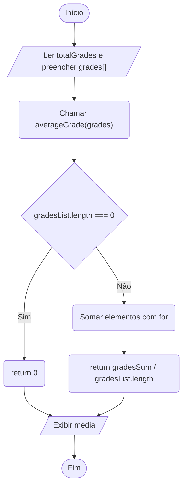

<div align="center">

  🇺🇸 **[English Version](README.md)**
  <br>

  # 🎯 Média Modular de Notas com Função (`ModularGradesAverage.ts`)

</div>

> **Origem:** Aula 09 (Funções, Escopo, Assinatura e Modularização)  
> **Tópico:** Array como Parâmetro (`number[]`), Cláusula de Guarda e Modularização com `if`/`for`

---

## 🎯 Enunciado do Problema

Neste último exercício da Aula 09, o professor pediu para calcular a média de `N` notas guardadas em um array, deixando o cálculo sob responsabilidade de uma função e usando apenas `if` e `for`. Escrevi a função `averageGrade(gradesList: number[]): number` com uma verificação inicial (`if (gradesList.length === 0) return 0`) para evitar divisão de zero por zero (`NaN`) caso o array esteja vazio.

---

## 📊 Fluxograma (ISO / ANSI)



---

## 🧪 Teste de Mesa (Rastreamento em Memória)

Simulação dentro de `averageGrade([8, 9, 7])`:

| Etapa | `i` | `gradesList[i]` | `gradesSum` | Retorno |
| :--- | :---: | :---: | :---: | :---: |
| **Cláusula de guarda** | - | `length = 3` (diferente de 0) | `0` | - |
| **Iteração 0** | `0` | `8` | `8` | - |
| **Iteração 1** | `1` | `9` | `17` | - |
| **Iteração 2** | `2` | `7` | `24` | - |
| **Divisão** | - | - | `24` | `24 / 3 = 8` |

---

## 💻 Código-Fonte

O código completo está em [ModularGradesAverage.ts](ModularGradesAverage.ts).

---

## 🖥️ Saída no Terminal

```text
==================================================
       Modular Grades Average with Function
==================================================
How many grades do you want to enter? 3
Grade 1: 8
Grade 2: 9
Grade 3: 7

Recorded grades: [ 8, 9, 7 ]
Average: 8.00
==================================================
```

---

## 💡 Principais Conceitos Aplicados

- **Array como Parâmetro:** Tipar o parâmetro como `gradesList: number[]` permite que a função aceite listas de qualquer tamanho com checagem estrita de tipos.
- **Cláusula de Guarda contra `NaN`:** Checar `if (gradesList.length === 0) return 0;` no começo evita dividir `0 / 0` quando nenhuma nota é informada.
- **Evolução do Problema:** Em relação à Aula 07 (`12-dynamic-grades-average`), mover a soma e a divisão para `averageGrade()` isola o cálculo para poder reutilizá-lo em qualquer lugar.

---

## 🚀 Como Executar

```bash
# Execução direta via tsx
npx tsx src/15-modular-grades-average/ModularGradesAverage.ts
```
